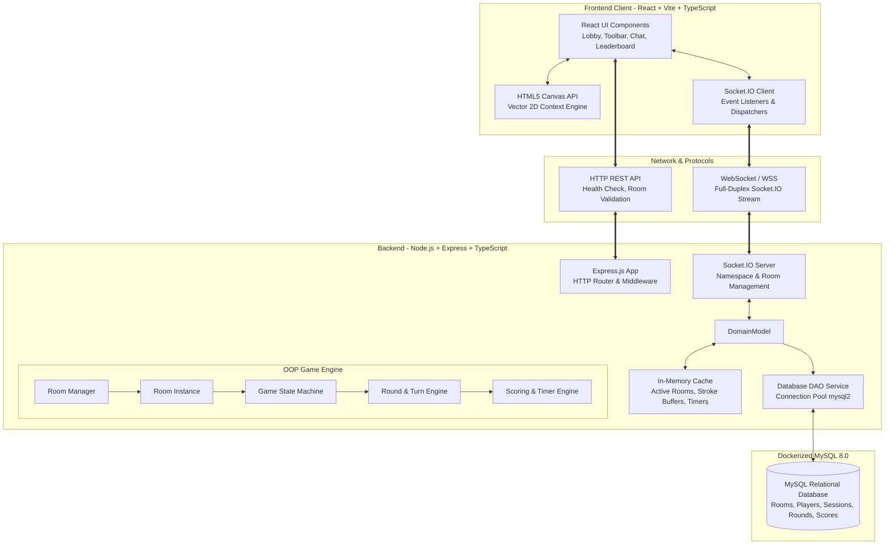
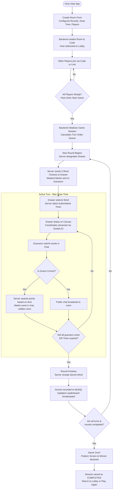
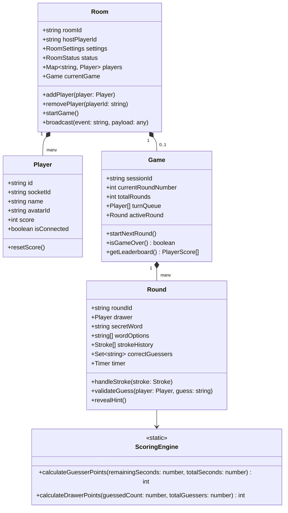

# System Architecture Specification — Skribbl.io Clone

This document provides the foundational architectural specification for the real-time multiplayer drawing and guessing game (*Skribbl.io Clone*). It covers high-level system components, data flow, Socket.IO real-time events, server-authoritative state management, object-oriented design, and comparisons with Spring Boot concepts.

---

## 1. High-Level System Architecture

---

## 2. Complete Game Workflow

The entire lifecycle of a Skribbl.io match from room setup to podium is visualized below:

---

## 3. Four-Player Walkthrough Example

To clearly understand how state, drawing, and guessing interact, consider a match with 4 players:
- **Alice** (Host, Drawer in Turn 1)
- **Bob** (Guesser)
- **Charlie** (Guesser)
- **Dana** (Guesser)

### Step-by-Step Execution:
1. **Room Creation:** Alice sets Draw Time = 60s, Rounds = 2. Server creates Room Code `SKR-482`. Alice enters the Lobby.
2. **Joining:** Bob, Charlie, and Dana enter `SKR-482`. The server emits `player_joined` after each entry. The client lobby lists all 4 players in real time.
3. **Game Start:** Alice clicks "Start Game". Server transitions `Room.status` from `'LOBBY'` to `'PLAYING'`.
4. **Word Selection:**
   - Server picks 3 random words: `['Guitar', 'Elephant', 'Rocket']`.
   - Server emits `round_start` with `{ wordOptions: ['Guitar', 'Elephant', 'Rocket'] }` **only to Alice's socket**.
   - Server emits `game_state` to Bob, Charlie, and Dana with word length mask `_ _ _ _ _ _` (6 letters).
   - Alice clicks `'Rocket'`. Alice emits `word_chosen { word: 'Rocket' }`.
   - Server starts the 60-second countdown timer.
5. **Drawing & Real-Time Sync:**
   - Alice presses mouse at `(120, 200)` and drags to `(180, 250)`.
   - Alice's client emits `draw_start` and multiple `draw_move` events.
   - Server verifies: *Is Alice the active drawer? Yes.*
   - Server broadcasts `draw_data` to Bob, Charlie, and Dana. Their canvases render the stroke in real time with `<15ms` latency.
6. **Guessing:**
   - Bob types `"Airplane"`. Server checks `"airplane" === "rocket"` ➔ False. Server broadcasts Bob's guess as a normal chat message: `"Bob: Airplane"`.
   - Charlie types `"Rocket"`. Server checks `"rocket" === "rocket"` ➔ True!
   - Server awards Charlie 450 points (based on remaining time) and Alice 100 points (drawer reward).
   - Server emits `guess_result` to Charlie confirming correctness.
   - Server broadcasts to all: `"Charlie guessed the word!"` (the word `"Rocket"` is concealed from Bob and Dana).
   - Charlie's subsequent chat messages are hidden from players who haven't guessed yet.
7. **Round End & Database Persistence:**
   - Dana guesses at 10 seconds remaining. Bob fails to guess before timer hits 0.
   - Timer hits 0. Server emits `round_end { word: 'Rocket', scores: [...] }`.
   - Server asynchronously inserts the round result and player scores into MySQL tables `game_rounds` and `player_round_scores`.
8. **Turn Rotation:**
   - Turn 2 begins: Bob becomes the drawer. Repeat until all 4 players draw across 2 rounds.
   - Server emits `game_over { winner: 'Charlie', leaderboard: [...] }`.

---

## 4. Socket.IO Protocol Specification

All WebSocket communication is structured around strictly defined events:

### 4.1 Room & Lobby Events
| Event Name | Direction | Payload | Description |
|---|---|---|---|
| `create_room` | Client ➔ Server | `{ hostName: string, settings: RoomSettings }` | Host requests new room creation |
| `join_room` | Client ➔ Server | `{ roomId: string, playerName: string, avatarId?: string }` | Player joins room |
| `player_joined` | Server ➔ Clients | `{ player: PlayerDTO, players: PlayerDTO[] }` | Broadcast to all room members |
| `player_left` | Server ➔ Clients | `{ playerId: string, players: PlayerDTO[] }` | Broadcast player disconnect |
| `start_game` | Client ➔ Server | `{}` (Must originate from room host) | Host triggers match start |

### 4.2 Game State & Turn Events
| Event Name | Direction | Payload | Description |
|---|---|---|---|
| `game_state` | Server ➔ Clients | `{ phase: GamePhase, round: number, drawerId: string, wordMask: string, hints: string[] }` | Full room state sync |
| `round_start` | Server ➔ Clients | `{ drawerId: string, wordOptions?: string[], drawTime: number }` | Sent at round initiation (drawer receives wordOptions) |
| `word_chosen` | Client ➔ Server | `{ word: string }` | Emitted by drawer to lock word and trigger timer |
| `round_end` | Server ➔ Clients | `{ word: string, scores: PlayerScoreDTO[], nextDrawerId: string }` | Word revealed; scores updated |
| `game_over` | Server ➔ Clients | `{ winner: PlayerDTO, leaderboard: PlayerScoreDTO[] }` | Final game podium |

### 4.3 Drawing Events
| Event Name | Direction | Payload | Description |
|---|---|---|---|
| `draw_start` | Client ➔ Server | `{ x: number, y: number, color: string, size: number, tool: 'pen'\|'eraser' }` | Initiates stroke |
| `draw_move` | Client ➔ Server | `{ x: number, y: number }` | Intermediate stroke point |
| `draw_end` | Client ➔ Server | `{}` | Concludes active stroke |
| `draw_data` | Server ➔ Clients | `{ type: 'start'\|'move'\|'end', ...coords }` | Broadcast stroke packet |
| `canvas_clear` | Client ➔ Server | `{}` | Clears drawer's canvas & broadcasts to room |
| `draw_undo` | Client ➔ Server | `{}` | Reverts last completed stroke from buffer |

### 4.4 Chat & Guessing Events
| Event Name | Direction | Payload | Description |
|---|---|---|---|
| `guess` | Client ➔ Server | `{ text: string }` | Player submits word guess |
| `guess_result` | Server ➔ Clients | `{ correct: boolean, playerId: string, playerName: string, points?: number }` | Evaluation outcome |
| `chat` | Client ➔ Server | `{ text: string }` | General message |
| `chat_message` | Server ➔ Clients | `{ playerId: string, playerName: string, text: string, type: 'chat'\|'system'\|'success' }` | Room chat broadcast |

---

## 5. Object-Oriented Backend Domain Model (Bonus Architecture)

To ensure modular, testable, and maintainable server logic, we encapsulate real-time mechanics in domain classes:

---

## 6. Conceptual Mapping: Node.js vs Java / Spring Boot

| Architectural Concern | Java / Spring Boot Implementation | Our Node.js + TypeScript Implementation |
|---|---|---|
| **Server Framework** | Spring Boot (`@SpringBootApplication`) | Express.js (`express()`) |
| **HTTP Routing** | `@RestController`, `@GetMapping`, `@PostMapping` | `express.Router()`, `router.get()`, `router.post()` |
| **WebSocket Layer** | Spring WebSocket + STOMP (`@MessageMapping`, `SimpMessagingTemplate`) | Socket.IO (`io.on('connection')`, `io.to(roomId).emit()`) |
| **Connection State** | ConcurrentHashMap / SessionRegistry | In-memory JavaScript `Map<string, Room>` and Object instances |
| **Database Persistence** | Spring Data JPA / Hibernate (`JpaRepository<T, ID>`) | `mysql2/promise` connection pool with DAO patterns |
| **Dependency Injection** | Spring IoC Container (`@Autowired`, `@Service`, `@Component`) | TypeScript module exports / Constructor injection |
| **Background Timers** | `@Scheduled` / `ScheduledExecutorService` | Native Node.js `setInterval()` / `setTimeout()` managed per `Round` |
| **Containerization** | Dockerfile running OpenJDK JAR + Docker Compose | Dockerfile running Node Alpine + Docker Compose |

---

## 7. Security & Anti-Cheat Controls

1. **Server-Authoritative Drawing:** Only the socket matching `Round.drawer.socketId` can trigger canvas modifications.
2. **Secret Word Masking:** The word is masked before transmission; clients never receive the string until `round_end`.
3. **Guess Suppression:** Once a player guesses the word, their subsequent chat submissions containing the secret word are suppressed from guessing players' views.
4. **Input Sanitization:** User names and chat strings are trimmed, length-limited, and escaped to prevent XSS.

---

## 8. Deployment Strategy

- **Development:**
  - Docker Compose runs MySQL 8.0 on port `3306` with persistent volume `mysql_data`.
  - Node.js backend runs with `tsx` (TypeScript execution with hot-reload) on port `5000`.
  - React frontend runs with Vite HMR on port `5173`.
- **Production:**
  - Backend deployed to **Render** or **Railway** as a persistent Node.js service (full WebSocket support).
  - MySQL database hosted on **Aiven**, **Railway**, or **Render Managed Database**.
  - Frontend built via `npm run build` and served either through the Express static server or hosted on **Vercel** / **Render**.
