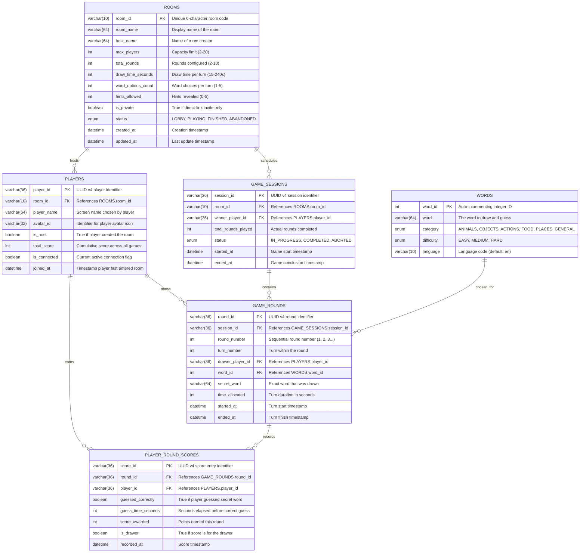

# MySQL Database Schema & Architecture

This document defines the persistent relational database architecture for the Skribbl.io clone application. The database is hosted inside a Docker container using MySQL 8.0, managed via Docker Compose with a persistent volume.

---

## 1. Persistence Philosophy: MySQL vs Server In-Memory State

In a real-time multiplayer drawing and guessing game, data belongs to one of two categories:

| Dimension | Ephemeral In-Memory State (Node.js RAM) | Persistent Relational State (MySQL 8.0) |
|---|---|---|
| **Examples** | Mouse coordinates, active canvas strokes, active timers, socket IDs, current word choice options, unmasked secret word | Room metadata, game history, round summaries, player final scores, leaderboard records, global word catalog |
| **Frequency** | 30–60 events per second per player | Written once per room creation, round completion, and game finish |
| **Access Latency** | Sub-millisecond (RAM access) | 1–5 milliseconds (Disk / InnoDB Buffer Pool) |
| **Durability** | Lost if node process restarts | Persisted permanently to Docker volume (`mysql_data`) |
| **Design Justification** | Writing every mouse pixel coordinate to MySQL would overload the I/O bus and cause severe lag for players | Clean relational audit trail for completed matches, analytics, and historical player statistics |

---

## 2. Entity-Relationship (ER) Diagram



---

## 3. Detailed Table Specifications (DDL)

### 3.1 Table: `rooms`
Stores persistent room definitions and host settings.
```sql
CREATE TABLE IF NOT EXISTS rooms (
    room_id VARCHAR(10) NOT NULL,
    room_name VARCHAR(64) NOT NULL DEFAULT 'Skribbl Room',
    host_name VARCHAR(64) NOT NULL,
    max_players INT NOT NULL DEFAULT 8,
    total_rounds INT NOT NULL DEFAULT 3,
    draw_time_seconds INT NOT NULL DEFAULT 80,
    word_options_count INT NOT NULL DEFAULT 3,
    hints_allowed INT NOT NULL DEFAULT 2,
    is_private BOOLEAN NOT NULL DEFAULT FALSE,
    status ENUM('LOBBY', 'PLAYING', 'FINISHED', 'ABANDONED') NOT NULL DEFAULT 'LOBBY',
    created_at TIMESTAMP DEFAULT CURRENT_TIMESTAMP,
    updated_at TIMESTAMP DEFAULT CURRENT_TIMESTAMP ON UPDATE CURRENT_TIMESTAMP,
    PRIMARY KEY (room_id),
    INDEX idx_rooms_status (status),
    INDEX idx_rooms_created (created_at)
) ENGINE=InnoDB DEFAULT CHARSET=utf8mb4 COLLATE=utf8mb4_unicode_ci;
```

### 3.2 Table: `players`
Maintains player profiles associated with rooms.
```sql
CREATE TABLE IF NOT EXISTS players (
    player_id VARCHAR(36) NOT NULL,
    room_id VARCHAR(10) NOT NULL,
    player_name VARCHAR(64) NOT NULL,
    avatar_id VARCHAR(32) NOT NULL DEFAULT 'avatar_1',
    is_host BOOLEAN NOT NULL DEFAULT FALSE,
    total_score INT NOT NULL DEFAULT 0,
    is_connected BOOLEAN NOT NULL DEFAULT TRUE,
    joined_at TIMESTAMP DEFAULT CURRENT_TIMESTAMP,
    PRIMARY KEY (player_id),
    CONSTRAINT fk_players_room FOREIGN KEY (room_id) REFERENCES rooms(room_id) ON DELETE CASCADE,
    INDEX idx_players_room (room_id)
) ENGINE=InnoDB DEFAULT CHARSET=utf8mb4 COLLATE=utf8mb4_unicode_ci;
```

### 3.3 Table: `game_sessions`
Represents an entire match from "Start Game" until the final podium.
```sql
CREATE TABLE IF NOT EXISTS game_sessions (
    session_id VARCHAR(36) NOT NULL,
    room_id VARCHAR(10) NOT NULL,
    winner_player_id VARCHAR(36) NULL,
    total_rounds_played INT NOT NULL DEFAULT 0,
    status ENUM('IN_PROGRESS', 'COMPLETED', 'ABORTED') NOT NULL DEFAULT 'IN_PROGRESS',
    started_at TIMESTAMP DEFAULT CURRENT_TIMESTAMP,
    ended_at TIMESTAMP NULL,
    PRIMARY KEY (session_id),
    CONSTRAINT fk_sessions_room FOREIGN KEY (room_id) REFERENCES rooms(room_id) ON DELETE CASCADE,
    CONSTRAINT fk_sessions_winner FOREIGN KEY (winner_player_id) REFERENCES players(player_id) ON DELETE SET NULL,
    INDEX idx_sessions_room (room_id)
) ENGINE=InnoDB DEFAULT CHARSET=utf8mb4 COLLATE=utf8mb4_unicode_ci;
```

### 3.4 Table: `words`
Master dictionary of categorized words available for selection.
```sql
CREATE TABLE IF NOT EXISTS words (
    word_id INT AUTO_INCREMENT NOT NULL,
    word VARCHAR(64) NOT NULL UNIQUE,
    category ENUM('ANIMALS', 'OBJECTS', 'ACTIONS', 'FOOD', 'PLACES', 'GENERAL') NOT NULL DEFAULT 'GENERAL',
    difficulty ENUM('EASY', 'MEDIUM', 'HARD') NOT NULL DEFAULT 'EASY',
    language VARCHAR(10) NOT NULL DEFAULT 'en',
    PRIMARY KEY (word_id),
    INDEX idx_words_category (category),
    INDEX idx_words_difficulty (difficulty)
) ENGINE=InnoDB DEFAULT CHARSET=utf8mb4 COLLATE=utf8mb4_unicode_ci;
```

### 3.5 Table: `game_rounds`
Records each individual turn/round played in a game session.
```sql
CREATE TABLE IF NOT EXISTS game_rounds (
    round_id VARCHAR(36) NOT NULL,
    session_id VARCHAR(36) NOT NULL,
    round_number INT NOT NULL,
    turn_number INT NOT NULL,
    drawer_player_id VARCHAR(36) NOT NULL,
    word_id INT NULL,
    secret_word VARCHAR(64) NOT NULL,
    time_allocated INT NOT NULL,
    started_at TIMESTAMP DEFAULT CURRENT_TIMESTAMP,
    ended_at TIMESTAMP NULL,
    PRIMARY KEY (round_id),
    CONSTRAINT fk_rounds_session FOREIGN KEY (session_id) REFERENCES game_sessions(session_id) ON DELETE CASCADE,
    CONSTRAINT fk_rounds_drawer FOREIGN KEY (drawer_player_id) REFERENCES players(player_id) ON DELETE CASCADE,
    CONSTRAINT fk_rounds_word FOREIGN KEY (word_id) REFERENCES words(word_id) ON DELETE SET NULL,
    INDEX idx_rounds_session (session_id)
) ENGINE=InnoDB DEFAULT CHARSET=utf8mb4 COLLATE=utf8mb4_unicode_ci;
```

### 3.6 Table: `player_round_scores`
Fine-grained audit of points scored per player in each turn.
```sql
CREATE TABLE IF NOT EXISTS player_round_scores (
    score_id VARCHAR(36) NOT NULL,
    round_id VARCHAR(36) NOT NULL,
    player_id VARCHAR(36) NOT NULL,
    guessed_correctly BOOLEAN NOT NULL DEFAULT FALSE,
    guess_time_seconds INT NULL,
    score_awarded INT NOT NULL DEFAULT 0,
    is_drawer BOOLEAN NOT NULL DEFAULT FALSE,
    recorded_at TIMESTAMP DEFAULT CURRENT_TIMESTAMP,
    PRIMARY KEY (score_id),
    CONSTRAINT fk_scores_round FOREIGN KEY (round_id) REFERENCES game_rounds(round_id) ON DELETE CASCADE,
    CONSTRAINT fk_scores_player FOREIGN KEY (player_id) REFERENCES players(player_id) ON DELETE CASCADE,
    INDEX idx_scores_round (round_id),
    INDEX idx_scores_player (player_id)
) ENGINE=InnoDB DEFAULT CHARSET=utf8mb4 COLLATE=utf8mb4_unicode_ci;
```

---

## 4. Lifecycle Data Flow: Read & Write Operations

1. **Room Creation:**
   - Client sends `create_room` payload.
   - Server writes a row to `rooms` and registers the host in `players`.
   - In-memory `Room` instance initialized in Node.js.
2. **Player Joins:**
   - Client sends `join_room` payload.
   - Server validates room capacity and status in memory.
   - Server inserts row into `players`.
3. **Game Start:**
   - Host emits `start_game`.
   - Server inserts row into `game_sessions` with status `'IN_PROGRESS'`.
   - `Room.status` updated to `'PLAYING'`.
4. **Round Start:**
   - Server selects drawer, fetches word options from in-memory pool (seeded from `words` table or JSON).
   - Drawer picks word.
   - Server inserts row into `game_rounds`.
5. **Drawing & Guessing (Real-Time In-Memory Only):**
   - Strokes flow between sockets without touching MySQL.
   - Correct guesses update in-memory player score structures.
6. **Round End:**
   - Timer expires or all players guessed.
   - Server flushes `player_round_scores` rows (one per participant) to MySQL in a single batch query.
   - `game_rounds.ended_at` timestamp recorded.
7. **Game Over:**
   - All configured rounds complete.
   - Winner calculated; `game_sessions` row updated (`status='COMPLETED'`, `winner_player_id`, `ended_at`).
   - Final scores updated in `players` table.

---

## 5. Comparison with Java & Spring Boot

For developers with Spring Boot background, here is how our Node.js + MySQL architecture maps to familiar Spring concepts:

| Spring Boot Component | Equivalent in our Node.js / TypeScript Stack |
|---|---|
| `@Entity` class (`RoomEntity`, `PlayerEntity`) | TypeScript interfaces + SQL Schema scripts |
| `Spring Data JPA` (`JpaRepository<Room, String>`) | `mysql2` connection pool + lightweight DAO queries |
| `application.properties` / `application.yml` | `.env` file loaded via `dotenv` |
| `Flyway` / `Liquibase` migrations | Versioned SQL migration scripts executed on startup |
| `HikariCP` connection pool | `mysql2.createPool({ connectionLimit: 10, ... })` |
| `@Transactional` method boundary | `const connection = await pool.getConnection(); await connection.beginTransaction(); ... commit();` |
| `@OneToMany` / `@ManyToOne` cascade | SQL foreign key constraints (`ON DELETE CASCADE`) |

---

## 6. Interview Preparation: Database Architecture Questions

### Q1: Why not store every drawing stroke in MySQL?
**Answer:** "A single drawer generates 30 to 60 stroke events per second. Across 10 active rooms, that would equate to 300–600 write queries per second. Relational databases like MySQL are optimized for ACID-compliant structured transactions, not high-frequency telemetry. Writing strokes to MySQL would saturate database connections and introduce intolerable latency. Instead, we buffer strokes in server memory for the duration of the round and broadcast them via WebSockets, persisting only round summaries and scores to MySQL upon round completion."

### Q2: What is the purpose of the `status` enum in `rooms` and `game_sessions`?
**Answer:** "The `status` enum provides an explicit state-machine boundary. It prevents players from joining games that have already finished (`FINISHED` or `ABANDONED`) and distinguishes active lobbies from in-flight rounds, ensuring clean validation before socket connection acceptance."

### Q3: How do you prevent SQL injection in Node.js?
**Answer:** "We use prepared statements with parameterized queries provided by the `mysql2/promise` library (`pool.execute('SELECT * FROM rooms WHERE room_id = ?', [roomId])`). The database driver escapes and types input values independently from the SQL command structure, rendering injection impossible."
