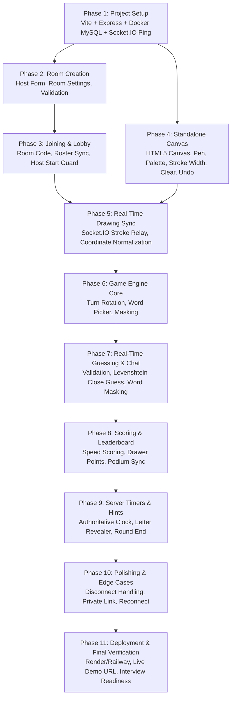

# Phased Development Roadmap — Skribbl.io Clone

This roadmap outlines the incremental, dependency-aware implementation plan for the Skribbl.io clone. Every phase builds strictly upon verified previous phases, ensuring zero regressions and high conceptual clarity for final technical interview preparation.

---

## Dependency & Implementation Graph

---

## Phase-by-Phase Plan

### Phase 1: Project Setup & Baseline Infrastructure
- **Objective:** Establish the mono-repo structure with React/TypeScript/Vite frontend, Node.js/Express/TypeScript backend, Docker Compose MySQL container, and initial Socket.IO connectivity.
- **Technologies:** React, Vite, TypeScript, Express, Socket.IO, Docker, Docker Compose, MySQL 8.0.
- **Deliverables:**
  - `docker-compose.yml` defining MySQL container with persistent volume.
  - Server boilerplate with health endpoint (`GET /api/health`) and Socket.IO handshake.
  - Frontend boilerplate with socket connection status indicator.
  - Initial database migration creating base tables (`rooms`, `players`).
- **Verification Criteria:**
  - Docker container running with MySQL responding to queries.
  - Frontend connects to Socket.IO server and displays `"Connected"`.
  - Typecheck passes cleanly with zero compiler warnings.

---

### Phase 2: Room Creation & Settings Validation
- **Objective:** Allow a host to enter their nickname, configure game settings (players, rounds, draw time, word count), and generate a unique room code.
- **Technologies:** React Forms, Zod/Joi validation, MySQL insertion, REST/Socket handler.
- **Prerequisites:** Phase 1 complete.
- **Deliverables:**
  - `CreateRoom` page with intuitive slider controls and validation.
  - Backend `create_room` handler validating boundaries (players: 2–20, rounds: 2–10, draw time: 15–240s).
  - Insertion into `rooms` table in MySQL and in-memory `Room` instance creation.
- **Verification Criteria:**
  - Submitting form generates unique 6-character room code.
  - Database table `rooms` contains exact configured values.
  - Host socket joins Socket.IO room identifier.

---

### Phase 3: Joining Rooms & Lobby System
- **Objective:** Enable other players to join using room code or link, view real-time lobby roster, and enforce host-only game start permissions.
- **Technologies:** React Router (or view state), Socket.IO room broadcast (`player_joined`, `player_left`).
- **Prerequisites:** Phase 2 complete.
- **Deliverables:**
  - `JoinRoom` page allowing room code entry and nickname selection.
  - Real-time `Lobby` component listing all connected players and host badge.
  - `start_game` event handler verifying sender is room host.
- **Verification Criteria:**
  - Opening two browser windows allows Player 2 to join Player 1's room.
  - Both windows immediately display both player names in lobby.
  - Non-host cannot start game; host clicking "Start Game" emits `start_game` to all members.

---

### Phase 4: Standalone HTML5 Drawing Canvas
- **Objective:** Build a robust, responsive 2D HTML5 canvas component with brush strokes, color palette, line width picker, eraser tool, undo, and canvas clear.
- **Technologies:** HTML5 Canvas API, React `useRef`, Pointer Events API.
- **Prerequisites:** Phase 1 complete (can be developed independently before network sync).
- **Deliverables:**
  - `Canvas` component with smooth Bézier/line interpolation.
  - `CanvasToolbar` with color swatches, brush size slider, eraser mode, undo button, and clear button.
  - In-memory stroke buffer supporting local undo.
- **Verification Criteria:**
  - Drawing on canvas produces smooth, continuous lines without jitter.
  - Clicking undo cleanly removes last stroke.
  - Clear canvas resets the canvas to white.

---

### Phase 5: Real-Time Drawing Synchronization
- **Objective:** Stream canvas strokes in real time between the active drawer and all room spectators with sub-20ms latency.
- **Technologies:** Socket.IO binary/JSON event streaming (`draw_start`, `draw_move`, `draw_end`, `draw_data`, `canvas_clear`, `draw_undo`).
- **Prerequisites:** Phase 3 and Phase 4 complete.
- **Deliverables:**
  - Drawer emits normalized coordinate packets (`x / width`, `y / height`).
  - Server validates drawer permissions and relays `draw_data` to room participants.
  - Guessers' canvases render received strokes identically regardless of monitor size.
  - Server maintains round stroke buffer to restore canvas for mid-turn joiners.
- **Verification Criteria:**
  - Drawing in Drawer window renders simultaneously in Guesser window in real time.
  - Guesser cannot draw or clear canvas (controls disabled and server rejects inputs).
  - Undo and Clear actions reflect across all connected viewports.

---

### Phase 6: Game Engine — Turns, Word Selection & Masking
- **Objective:** Orchestrate turn-based gameplay, cycle through drawer queue, offer random word choices to the drawer, and broadcast masked blanks to guessers.
- **Technologies:** OOP Game State Machine (`Game`, `Round`), Word catalog JSON/DB.
- **Prerequisites:** Phase 5 complete.
- **Deliverables:**
  - Word catalog categorized by animals, objects, actions, food.
  - Drawer receives `round_start` with 3 word options; selects one via modal.
  - Guessers receive masked blank format (e.g. `_ _ _ _ _`).
  - Strict security guard: secret word is never exposed to guessing sockets.
- **Verification Criteria:**
  - Drawer modal pops up with 3 distinct words.
  - Selecting word transitions room into drawing phase.
  - DevTools inspection on guesser window confirms secret word string is nowhere in memory or network frames.

---

### Phase 7: Real-Time Guessing & Chat Engine
- **Objective:** Enable players to submit guesses via chat, validate correctness, award early guess bonuses, mask correct guesses, and provide "close guess" feedback.
- **Technologies:** String normalization, Levenshtein distance algorithm, dual chat filter.
- **Prerequisites:** Phase 6 complete.
- **Deliverables:**
  - `ChatBox` component handling chat input and message stream.
  - Server validation matching guesses against active secret word.
  - Correct guess announcement (`"PlayerX guessed the word!"`) without exposing secret word.
  - Levenshtein distance check triggering private `"You are very close!"` prompt on 1-character typos.
- **Verification Criteria:**
  - Correct guess flags user as solved and halts further guessing for that player.
  - Other players see notification but cannot read the solved word in chat.
  - Close guess triggers yellow alert to the typing player.

---

### Phase 8: Scoring Engine & Live Leaderboard
- **Objective:** Implement server-authoritative scoring where faster guesses earn more points, drawer earns bonus when players guess, and live standings update dynamically.
- **Technologies:** Scoring algorithm, Leaderboard UI component, MySQL score persistence.
- **Prerequisites:** Phase 7 complete.
- **Deliverables:**
  - `ScoringEngine` awarding up to 500 points scaling down with remaining turn time.
  - Drawer compensation formula (points awarded proportional to guessing success).
  - Live animated leaderboard sorted descending by total score.
- **Verification Criteria:**
  - Faster guessers receive strictly higher points than slower guessers.
  - Leaderboard re-orders dynamically when scores update.
  - Round scores persist to `player_round_scores` table upon turn end.

---

### Phase 9: Authoritative Server Timers, Hints & Game End
- **Objective:** Implement server-side countdown clock, progressive letter hint reveals, turn conclusion triggers, and final game podium.
- **Technologies:** Node.js `setInterval`, Hint scheduler, Podium component.
- **Prerequisites:** Phase 8 complete.
- **Deliverables:**
  - Server timer emitting synchronized time remaining.
  - Progressive letter hints unmasking characters at 50% and 75% elapsed time.
  - Turn ends early if all guessers guess correctly.
  - Match completion triggers `game_over` with 1st, 2nd, and 3rd place podium.
- **Verification Criteria:**
  - Timer counts down consistently across all clients with zero client-side drift.
  - Hints reveal letters correctly without spoiling full word.
  - Final game screen displays true winner and records `COMPLETED` in `game_sessions`.

---

### Phase 10: Robustness, Disconnects & Polish
- **Objective:** Handle edge cases: drawer disconnections, host migration, room cleanup, and private room invite links.
- **Technologies:** Socket.IO disconnect handlers, deep link routing.
- **Prerequisites:** Phase 9 complete.
- **Deliverables:**
  - Graceful drawer departure (advances turn to next player without crashing room).
  - Host reassignment if host disconnects during lobby.
  - One-click copy invite link functionality (`/join/:roomId`).
- **Verification Criteria:**
  - Closing drawer's tab immediately skips to next drawer or ends round gracefully.
  - Room state remains consistent when players leave and re-enter.

---

### Phase 11: Deployment & Final Verification
- **Objective:** Deploy the full-stack application to public cloud hosting, verify end-to-end multiplayer operation over the Internet, and conduct final interview readiness drills.
- **Technologies:** Render/Railway, Cloud MySQL, GitHub repository, production build pipeline.
- **Prerequisites:** All previous phases complete and tested locally.
- **Deliverables:**
  - Publicly accessible live URL with active WebSockets.
  - Polished `README.md` with setup guide and deployment documentation.
  - Complete `PROJECT_WALKTHROUGH.md` and feature patch sets.
- **Verification Criteria:**
  - Two remote devices can join a room and play a complete game.
  - Full technical interview walkthrough ready to present.
