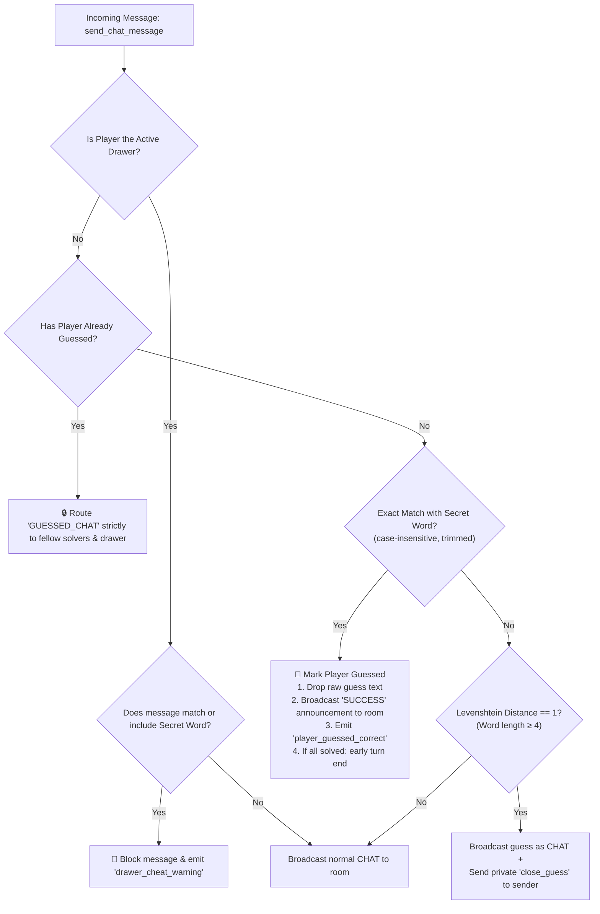

# Feature 07: Real-Time Chat & Guess Verification Engine

This document details the complete design, network protocols, server authority security, code implementation, testing, and interview defense for Phase 7: **Real-Time Chat & Guess Verification Engine**.

---

## 1. Feature Overview
Phase 7 implements the core real-time guessing loop, anti-cheat protection, fuzzy string matching, and dual-mode chat routing that powers Skribbl.io:
1. **Unified Chat & Guess Input:** Following authentic Skribbl.io design, players do not juggle between separate "Chat" and "Guess" tabs. A single input field at the bottom of the chat panel dynamically classifies and processes all messages.
2. **Zero-Trust Guess Verification (`GuessManager.ts`):** 
   - When a guesser submits the secret word (e.g. `PIZZA`, `  pizza  `, `Pizza`), the server matches it case-insensitively.
   - **Crucial Anti-Cheat:** The raw guess text `"pizza"` is **never broadcast** to other players in the room. Instead, the server marks the player as a solver and broadcasts a celebration banner: `🎉 [Player] guessed the word!`.
3. **Fuzzy Matching / "You're close!" System:**
   - Evaluates non-matching guesses with dynamic programming Levenshtein edit distance.
   - If a word has $\ge 4$ characters and the guess has an edit distance of exactly $1$ (e.g. `piza` for `pizza` or `aple` for `apple`), the message is broadcast as a normal guess, but the server delivers an exclusive private alert: `⚠️ You're close!`.
4. **Active Drawer Anti-Cheat Protection:**
   - The drawer cannot guess their own secret word.
   - If the drawer attempts to type the secret word into chat, the server **blocks the message** and emits a private warning: `⚠️ You are the drawer! You cannot type the secret word in chat.` Non-drawer players never see the message.
5. **Option A Authentic Solver Chat Isolation (Dual-Mode):**
   - Once a player has solved the word, any subsequent messages they send are tagged as `GUESSED_CHAT` and routed exclusively to other players who have also solved the word (plus the active drawer). Remaining guessers do not receive these messages, preventing verbal hints or spoilers.
6. **Early Turn Termination:**
   - If all eligible guessers solve the secret word before the turn timer expires, the server immediately triggers an early turn conclusion (`ALL_GUESSED`) without requiring players to wait out the remaining clock.
7. **Frontend 3-Column Arena (`GameView.tsx`, `ChatBox.tsx`):**
   - Roster (Left) $\vert$ Canvas & Toolbar (Center) $\vert$ ChatBox (Right).
   - Solved players receive a vibrant green `✅ Guessed` badge in the roster list.

---

## 2. Requirements Mapping
From [`docs/requirements-checklist.md`](file:///C:/Users/shub1/OneDrive/Desktop/Scribble/docs/requirements-checklist.md):
- **REQ-MH-07:** Guessing system: players type guesses in chat, server verifies against word. *(Must Have — Page 2, 5)*
- **REQ-SH-02:** Dual chat mode: guesses filtered from view if correct; general chat; notification broadcast. *(Should Have — Page 2, 4, 5)*
- **WebSocket Protocol Events:**
  - `send_chat_message` (Client ➔ Server)
  - `chat_message` (Server ➔ Room / Solvers)
  - `player_guessed_correct` (Server ➔ Room)
  - `close_guess` (Server ➔ Sender socket)
  - `drawer_cheat_warning` (Server ➔ Drawer socket)

---

## 3. Network Event Protocol & Payload Specifications

| Event | Direction | Payload | Description |
|---|---|---|---|
| `send_chat_message` | Client ➔ Server | `{ roomId: string, text: string }` | Sends chat or guess attempt. |
| `chat_message` | Server ➔ Room / Private | `{ id, senderId, senderName, text, type, timestamp }` | Broadcasts message with color-coded type (`CHAT`, `SUCCESS`, `SELF_SUCCESS`, `CLOSE_HINT`, `GUESSED_CHAT`, `WARNING`). |
| `player_guessed_correct` | Server ➔ Room | `{ roomId: string, playerId: string, playerName: string, guessOrder: number }` | Signals that a player solved the secret word; triggers roster checkmark. |
| `close_guess` | Server ➔ Guesser | `{ text: "You're close!" }` | Private socket alert for Levenshtein distance = 1. |
| `drawer_cheat_warning` | Server ➔ Drawer | `{ warning: string }` | Private alert blocking drawer from revealing the word. |

---

## 4. Message Classification Matrix



---

## 5. Levenshtein Distance Algorithm

Implemented in `backend/src/game/GuessManager.ts`:
Given string $s_1$ of length $m$ and string $s_2$ of length $n$:
$$D[i, j] = \begin{cases} 
\max(i, j) & \text{if } \min(i, j) = 0 \\
\min \begin{cases} D[i-1, j] + 1 \\ D[i, j-1] + 1 \\ D[i-1, j-1] + \text{cost} \end{cases} & \text{otherwise}
\end{cases}$$
Where $\text{cost} = 0$ if $s_1[i-1] = s_2[j-1]$, else $1$.
- **Space Optimization:** Uses two 1D rows (`prevRow`, `currRow`), reducing space complexity from $O(m \cdot n)$ to $O(\min(m, n))$.

---

## 6. Testing & Verification

Automated multi-client integration test [`backend/tests/chat_engine.test.js`](file:///C:/Users/shub1/OneDrive/Desktop/Scribble/backend/tests/chat_engine.test.js) executed cleanly:
```text
=== Phase 7 Real-Time Chat & Guess Verification Test Suite ===

--- Test 1: GuessManager String Normalization & Levenshtein Distance ---
✅ Levenshtein distance calculations verified (pizza vs piza = 1, apple vs aple = 1)
✅ GuessManager classification matrix verified across all 5 conditions

--- Test 2: Multi-Client Real-Time Chat, Anti-Cheat & Guess Routing ---
Alice (Host/Drawer) connected: hH7MhnbETWZfGCdnAAAH
✅ Step 1: Alice created room JS6Q9D
Bob (Guesser 1) connected: FdsuRc9XAmguhOzIAAAI
✅ Step 2: Bob joined room JS6Q9D
Charlie (Guesser 2) connected: OYq8xp2LEFiPtPmlAAAJ
✅ Step 3: Charlie joined room JS6Q9D
✅ Step 4: Alice received word options. Selecting "pizza"...
✅ Step 5: Turn started! Secret word is masked.

--- Action A: Drawer Alice attempts to type secret word in chat ---
✅ Action A Success: Server blocked Drawer typing secret word and sent private warning: You are the drawer! You cannot type the secret word in chat.

--- Action B: Bob sends regular incorrect guess ("burger") ---
✅ Action B Success: Regular wrong guess broadcast to room as CHAT: burger

--- Action C: Charlie sends close guess ("piza") ---
✅ Action C Success: Charlie received exclusive private "You're close!" notification!

--- Action D: Bob sends correct guess ("pizza") ---
✅ Action D Success: player_guessed_correct event received for BobGuesser (Order #1)!

--- Action E: Bob (in solver club) chats "good drawing" (Option A isolation) ---
✅ Action E Success: Drawer Alice received solver chat with [GUESSED_CHAT] badge!

--- Action F: Charlie solves word -> All guessers finished -> Early turn end ---
✅ Action F Success: Turn ended early (1ms) because all guessers solved!

🎉 ALL PHASE 7 REAL-TIME CHAT & GUESS VERIFICATION TESTS PASSED!
```
